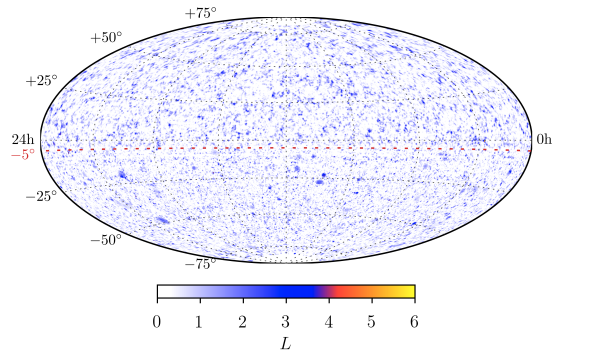

---
analysis_profile:
  category: pdf
  field: "Astroparticle physics"
  reason: "An explicit unbinned likelihood models signal and background. Scrambling or trials corrections calibrate significance, not the forward density."
  note: "Values for a single position on the sky. Total workload depends on the desired resolution."
  metrics:
    forward_model_core_hours: 0.00001
    parameter_count: 2
    analysis_core_hours: 0.3
    data_input_mb: 2400
    external_frameworks: 1
    software_stack_lines: 50000
    citation_count: 10
---

# IceCube · Source correlations

Combine public neutrino events and detector response with source catalogues in a sky likelihood.

!!! info "Reproduction status"

    **Scoped**. Independent validation pending. Status updated 2026-07-17.

## Scientific model

Model neutrino emission in various astrophysical sources and their detection with e.g. IceCube. Possible extensions could directly include numerical simulation of the source environment.

The reproduction objective below defines the current scope; a complete published-analysis reproduction is not asserted.

## Model ingredients

Reusing this model requires the ingredients below. Availability and limitations
are described in the reproduction evidence.

- Neutrino event sample
- source catalogue
- source spectrum
- forward model to observables: reconstructed muon energy and direction, per-event angular resolution
- trial-factor treatment and data-release provenance.

## Reproduction objective and evidence

**Objective:** Frequentist: MLEs of model parameters, significance map of the Sky, significance of tested source catalogues; Bayesian: posterior sample of model parameters, such as spectral index or number of point source events

**Scope and limitations:** The intended 2008–2022 data release is identified [DOI:10.7910/DVN/MMIIZA](https://doi.org/10.7910/DVN/MMIIZA). The forward model, catalog search and trial factor correction needs to be implemented.
## Figures

*Reference figure from the publication cited below.*

## Publications

- **Bellenghi:2023icecube** (2023) · [DOI:10.3847/2041-8213/acf711](https://doi.org/10.3847/2041-8213/acf711) · [arXiv:2309.03115](https://arxiv.org/abs/2309.03115)

[Back to model gallery](../index.md)
