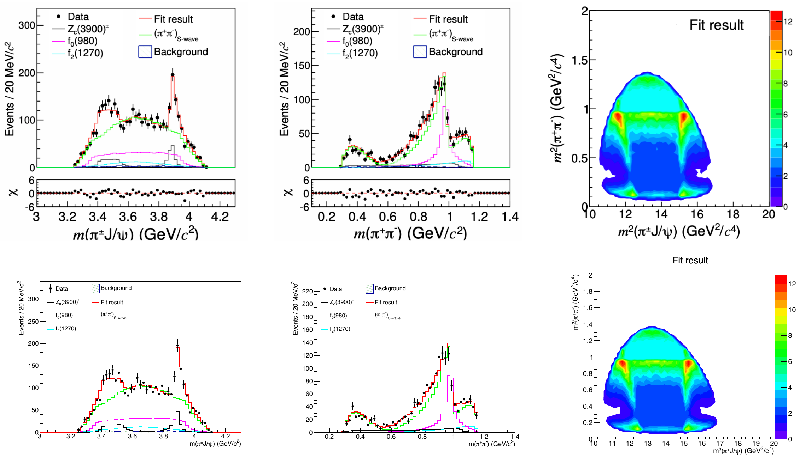

---
analysis_profile:
  category: measure
  field: "Hadron spectroscopy"
  reason: "The coherent sum of helicity amplitudes defines the unnormalised intensity; Monte Carlo integration provides the normalisation, accounting for detector acceptance."
  note: "The model has 17 floating and 10 fixed parameters. Analysis cost is estimated from a separate AmpTools fit performed solely for benchmarking. All computational costs and other metrics are approximate."
  metrics:
    forward_model_core_hours: 0.02
    parameter_count: 27
    analysis_core_hours: 0.03
    data_input_mb: 67
    external_frameworks: 1
    software_stack_lines: 4000
    citation_count: 1300
---

# BESIII · $e^+e^- \to \pi^+\pi^- J/\psi$

Reproduce the BESIII amplitude model for $e^+e^- \to \pi^+\pi^- J/\psi$ at $\sqrt{s} = 4.26$ GeV using the original fit parameters, and compare the resulting invariant mass distributions and Dalitz plot with the published results.

!!! info "Reproduction status"

    **In progress**. Independent validation pending. Status updated 2026-10-15.

## Scientific model

The model describes $e^+e^- \to \pi^+\pi^- J/\psi$ as a coherent sum of amplitudes corresponding to intermediate resonant contributions, including $Z_c(3900)^\pm$ and resonances in the $\pi^+\pi^-$ system.

## Model ingredients

- Monte Carlo simulations and normalisation integrals
- Decay chains and kinematic variables
- Helicity amplitudes, angular dependencies, and spin conventions
- Resonance lineshapes and parameters
- Complex amplitude coefficients

## Reproduction objective and evidence

**Objective:** Reproduce the full decay amplitude using the original parameters from the BESIII fit, allowing to project out individual contributions onto any kinematic variable of interest.

**Scope and limitations:** The reproduction uses the same BESIII Monte Carlo samples for the normalisation integrals. The amplitude parameters are initialised to the values obtained in the original BESIII analysis, no new fit is performed. Unbinned experimental event data are not publicly released.

**Implementation and checks:** The amplitude model is implemented in C++ using AmpTools. The reproduced distributions are compared with those shown in the original BESIII publication (see figures below). A future mapping to CascadeDecay.jl will provide an additional cross-check.

## Figures

**Top row:** Distributions from the original BESIII publication cited below
**Bottom row:** Corresponding reproduced distributions using the original BESIII amplitude parameters

{ target="_blank" rel="noopener" }

*Click the preview to open the full figure as a PDF.*

## Publications

- **Partial wave analysis of $e^+e^- \to \pi^+\pi^- J/\psi$ and cross section measurement of $e^+e^- \to \pi^\pm Z_c(3900)^\mp$ from 4.1271 to 4.3583 GeV** (2025) · [DOI: 10.48550/arXiv.2505.13222](https://doi.org/10.48550/arXiv.2505.13222) · [arXiv:2505.13222](https://arxiv.org/abs/2505.13222)
  - **Builds on:** *Observation of a Charged Charmoniumlike Structure in $e^+e^- \to \pi^+\pi^- J/\psi$ at $\sqrt{s}=4.26$ GeV* (2013) · [DOI: 10.1103/PhysRevLett.110.252001](https://doi.org/10.1103/PhysRevLett.110.252001) · [arXiv:1303.5949](https://arxiv.org/abs/1303.5949)

[Back to model gallery](../index.md)
