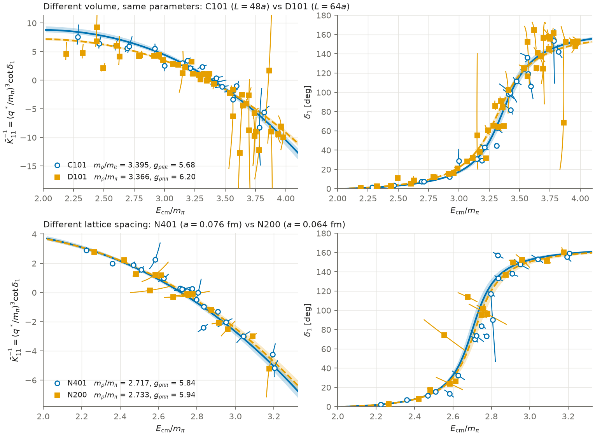

---
analysis_profile:
  category: measure
  field: "Lattice QCD"
  reason: "The quantization condition maps finite-volume energy levels to scattering amplitudes; it is not a normalized probability model. The statistical model is a correlated fit to bootstrap samples of the levels."
  note: "Two Breit–Wigner parameters per ensemble, six ensembles. Analysis cost is measured for 801 bootstrap fits per ensemble, about 2 core-hours in total. Other metrics are approximate."
  metrics:
    forward_model_core_hours: 0.001
    parameter_count: 12
    analysis_core_hours: 2
    data_input_mb: 1500
    external_frameworks: 2
    software_stack_lines: 1000
    citation_count: 140
---

# Lattice QCD · $I=1$ $\pi\pi$ amplitude and timelike pion form factor

Connect finite-volume two-pion energies from six lattice ensembles to the $\rho(770)$ scattering amplitude and the pion form factor.

!!! info "Reproduction status"

    **Reported reproduction**. Independent validation pending. Status updated 2026-11-19.

## Statistical model

Extract finite-volume two-pion energy levels from correlator matrices with a generalized eigenvalue problem (GEVP) and ratio fits. Map them to the elastic $p$-wave phase shift $\delta_1$ with the Lüscher quantization condition $\det[\tilde K^{-1}-B]=0$.

Fit $\tilde K_{11}^{-1}$ with a two-parameter Breit–Wigner shape, $g_{\rho\pi\pi}^2$ and $m_\rho^2/m_\pi^2$, using a correlated $\chi^2$ (determinant residual) on bootstrap samples. The timelike pion form factor then follows from vector-current matrix elements and a thrice-subtracted dispersion relation.

## Model ingredients

Reusing this model requires the ingredients below. Availability and limitations
are described in the reproduction evidence.

- Bootstrap samples of all correlation functions and one analysis file per ensemble (C101, D101, N401, N200, D200, J303)
- GEVP and fit choices: $(t_0,t_d)\approx(0.5,0.9)$ fm, $t_{\min}=0.7$–$1.3$ fm, $t_{\max}=2$–$2.6$ fm, ratio fits to the non-interacting levels
- lattice irreducible representations for each total momentum, pion masses, lattice spacing and volume
- quantization condition with the $\ell=1$ (and optionally $\ell=3$) partial waves
- Breit–Wigner $\tilde K_{11}^{-1}$ and the dispersive form-factor parametrization.

## Reproduction objective and evidence

**Objective:** Phase-shift $\delta_1(E_\mathrm{cm})$ and Breit–Wigner fit on each ensemble, starting from the released correlator bootstrap samples (Fig. 2 of the paper)

**Scope and limitations:** Reproduced on all six ensembles from the released correlators. The level extraction is a Python re-implementation of the released `jupan` notebook (SciPy instead of Minuit2); the quantization condition and the fit are written in FlatPPL. The $\ell=1,3$ fits and the timelike pion form factor are not reproduced, and the form factor is outside the objective. Independent audit pending.

## Released model and reported checks

The reproduction was run with FlatPPL 0.1 and flatppl-python 0.1.0. The pipeline splits as follows:

- **FlatPPL:** the Lüscher box quantity (zeta tensor as lattice sums with a fixed Gauss–Legendre rule), the Breit–Wigner $\tilde K_{11}^{-1}$, the determinant residual $\Omega(\mu=10)$ and the correlated $\chi^2$ over 801 bootstrap samples.
- **Python:** the GEVP and ratio fits, since FlatPPL has no eigensolver, and the loop of 801 minimizations, with gradients through the compiled FlatPPL module.

The reported fit results agree with the paper's tables within a small fraction of the quoted errors:

| Ensemble | Levels | $m_\rho/m_\pi$ (reproduction) | $m_\rho/m_\pi$ (paper) | $g_{\rho\pi\pi}$ (reproduction) | $g_{\rho\pi\pi}$ (paper) | $\hat\chi^2$ (reproduction) | $\hat\chi^2$ (paper) |
|---|---|---|---|---|---|---|---|
| C101 | 21 | 3.3953 (−0.0287 +0.0246) | 3.395(26) | 5.676 (−0.193 +0.137) | 5.67(17) | 1.063 | 1.07 |
| D101 | 43 | 3.3665 (−0.0152 +0.0157) | 3.366(15) | 6.197 (−0.102 +0.104) | 6.19(10) | 2.505 | 2.51 |
| N401 | 19 | 2.7175 (−0.0172 +0.0146) | 2.717(16) | 5.839 (−0.144 +0.101) | 5.84(12) | 1.641 | 1.64 |
| N200 | 15 | 2.7333 (−0.0139 +0.0185) | 2.733(16) | 5.941 (−0.101 +0.102) | 5.94(10) | 1.346 | 1.34 |
| D200 | 17 | 3.8779 (−0.0284 +0.0396) | 3.877(34) | 6.162 (−0.201 +0.187) | 6.16(19) | 0.808 | 0.81 |
| J303 | 18 | 3.0885 (−0.0234 +0.0263) | 3.089(25) | 6.303 (−0.174 +0.171) | 6.30(17) | 0.744 | 0.75 |

Every central value agrees with the paper to within 0.07 of its quoted error. All 133 levels in the paper's per-ensemble tables ($E_\mathrm{cm}$, $(q^*/m_\pi)^3\cot\delta_1$, $\delta_1$) agree to within 0.06 $\sigma$.

Reported cross-checks:

- fitted energies against the released $t_{\min}$ tables: at most $2\times10^{-4}$ in lattice units;
- FlatPPL box quantity against a NumPy reference: at most $3\times10^{-10}$;
- NumPy reference against the TwoHadronsInBox library used by the paper: $10^{-13}$;
- FlatPPL fits against an independent NumPy chain: at most $5\times10^{-6}$ per bootstrap sample.

The fits took about 3–4.5 minutes per ensemble for 801 bootstrap samples on 4 threads, plus about 1 minute for the level fits; the box quantity for all levels takes seconds. TODO: The FlatPPL implementation is not yet publicly released.

## Public release

- [Correlator data on Zenodo](https://doi.org/10.5281/zenodo.1341269) (CC BY 4.0, 1.5 GB): bootstrap samples of all correlation functions and one analysis file per ensemble, in HDF5. Download the files individually from `https://zenodo.org/api/records/1341269/files/<name>/content`; the bulk archive endpoint refuses scripted downloads.
- [jupan](https://github.com/ebatz/jupan): the Jupyter notebook that runs the paper's full analysis chain on these files.

## Figures

{ target="_blank" rel="noopener" }

*Reproduced $\tilde K_{11}^{-1}$ and $\delta_1$ with Breit–Wigner bands, compared between ensembles of different volume (top) and lattice spacing (bottom). Click to open the PDF.*

The N401/N200 row matches the published figure bar by bar. The C101/D101 row follows the paper's tables and is not reproduced point by point from the published figure.

*Reference figure from the publication cited below.*

## Publications

- **The $I=1$ pion-pion scattering amplitude and timelike pion form factor from $N_f=2+1$ lattice QCD** (2019) · [DOI: 10.1016/j.nuclphysb.2018.12.018](https://doi.org/10.1016/j.nuclphysb.2018.12.018) · [arXiv:1808.05007](https://arxiv.org/abs/1808.05007)
- **Estimating the two-particle $K$-matrix for multiple partial waves and decay channels from finite-volume energies** (2017) · [DOI: 10.1016/j.nuclphysb.2017.09.014](https://doi.org/10.1016/j.nuclphysb.2017.09.014) · [arXiv:1707.05817](https://arxiv.org/abs/1707.05817) · fit method used above

[Back to model gallery](../index.md)
