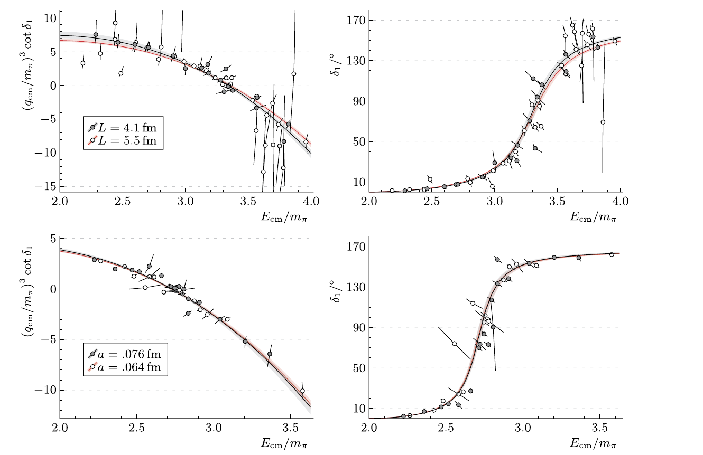

---
analysis_profile:
  category: measure
  field: "Lattice QCD"
  reason: "The quantization condition maps finite-volume energy levels to scattering amplitudes; it is not a normalized probability model. The statistical model is a correlated fit to bootstrap samples of the levels."
  note: "Approximate analysis-scale values; costs depend on the workload and implementation."
  metrics:
    forward_model_core_hours: 1
    parameter_count: 10
    analysis_core_hours: 100
    data_input_mb: 1500
    external_frameworks: 2
    software_stack_lines: 1000
    citation_count: 100
---

# Lattice QCD · $I=1$ $\pi\pi$ amplitude and timelike pion form factor

Connect finite-volume two-pion energies from six lattice ensembles to the $\rho(770)$ scattering amplitude and the pion form factor.

!!! info "Reproduction status"

    **In progress**. Independent validation pending. Status updated 2026-11-19.

## Statistical model

Extract finite-volume two-pion energy levels from correlator matrices with a generalized eigenvalue problem (GEVP) and ratio fits. Map them to the elastic $p$-wave phase shift $\delta_1$ with the Lüscher quantization condition $\det[\tilde K^{-1}-B]=0$.

Fit $\tilde K_{11}^{-1}$ with a two-parameter Breit–Wigner shape, $g_{\rho\pi\pi}^2$ and $m_\rho^2/m_\pi^2$, using a correlated $\chi^2$ (determinant residual) on bootstrap samples. The timelike pion form factor then follows from vector-current matrix elements and a thrice-subtracted dispersion relation.

## Model ingredients

Reusing this model requires the ingredients below. Availability and limitations
are described in the reproduction evidence.

- Bootstrap samples of all correlation functions and one analysis file per ensemble (C101, D101, N401, N200, D200, J303)
- GEVP and fit choices: $(t_0,t_d)\approx(0.5,0.9)$ fm, $t_{\min}=0.7$–$1.3$ fm, $t_{\max}=2$–$2.6$ fm, ratio fits to the non-interacting levels
- lattice irreducible representations for each total momentum, pion masses, lattice spacing and volume
- quantization condition with the $\ell=1$ (and optionally $\ell=3$) partial waves
- Breit–Wigner $\tilde K_{11}^{-1}$ and the dispersive form-factor parametrization.

## Reproduction objective and evidence

**Objective:** Phase-shift $\delta_1(E_\mathrm{cm})$ and Breit–Wigner fit on each ensemble, starting from the released correlator bootstrap samples (Fig. 2 of the paper)

**Scope and limitations:** The correlators, per-ensemble analysis choices and an analysis notebook are public, so the chain from energy levels to the Breit–Wigner fit can be rerun from released data. A reproduction has not yet been completed. The form-factor analysis is not part of this objective.

## Public release

- [Correlator data on Zenodo](https://doi.org/10.5281/zenodo.1341269) (CC BY 4.0, 1.5 GB): bootstrap samples of all correlation functions and one analysis file per ensemble, in HDF5.
- [jupan](https://github.com/ebatz/jupan): the Jupyter notebook that runs the full analysis chain on these files.

## Figures

*Reference figure from the publication cited below: $\tilde K_{11}^{-1}$ and $\delta_1$ compared between ensembles of different volume (top) and lattice spacing (bottom).*

## Publications

- **The $I=1$ pion-pion scattering amplitude and timelike pion form factor from $N_f=2+1$ lattice QCD** (2019) · [DOI: 10.1016/j.nuclphysb.2018.12.018](https://doi.org/10.1016/j.nuclphysb.2018.12.018) · [arXiv:1808.05007](https://arxiv.org/abs/1808.05007)
- **Estimating the two-particle $K$-matrix for multiple partial waves and decay channels from finite-volume energies** (2017) · [DOI: 10.1016/j.nuclphysb.2017.09.014](https://doi.org/10.1016/j.nuclphysb.2017.09.014) · [arXiv:1707.05817](https://arxiv.org/abs/1707.05817) · fit method used above

[Back to model gallery](../index.md)
